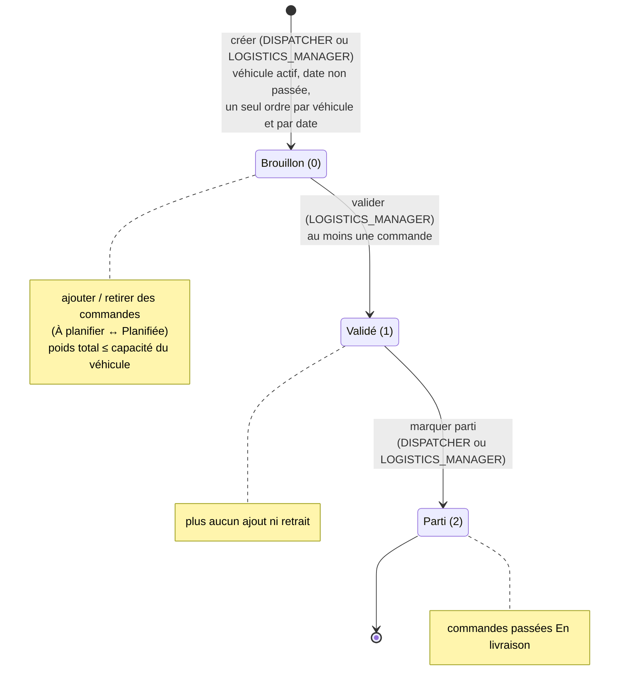
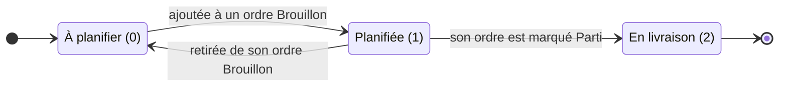
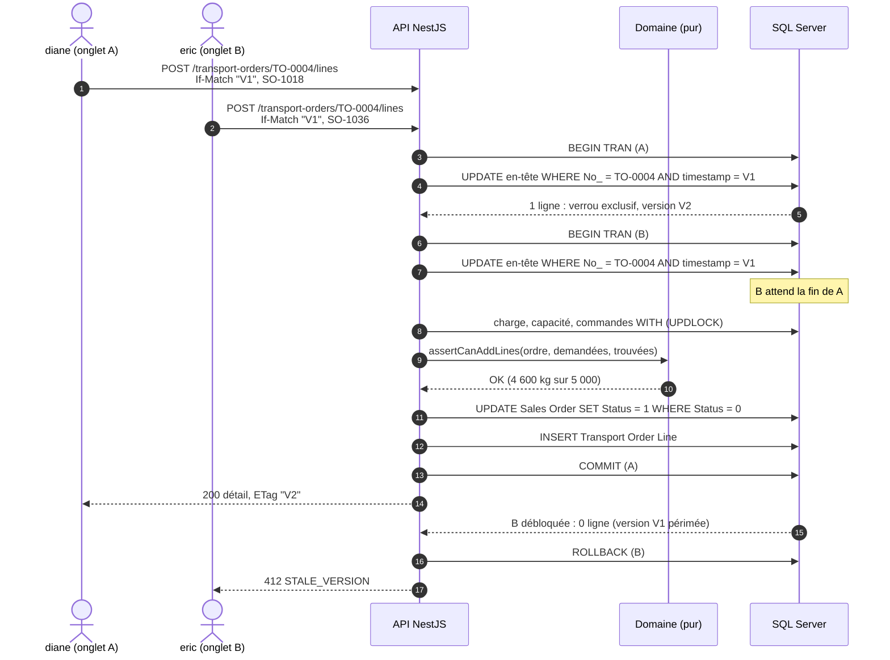
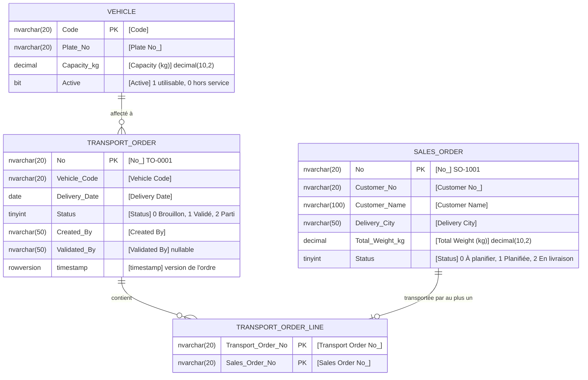
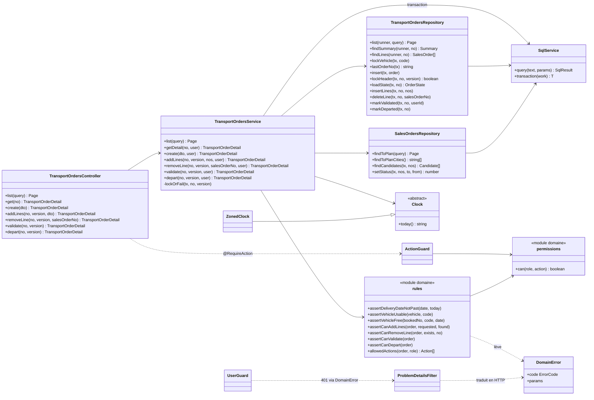

# Diagrammes

Sources Mermaid, rendues directement par GitHub. Détails dans la [spécification](01-specification.md) et les [ADR](adr/README.md).

## 1. Cycle de vie d'un ordre de transport

## 2. Cycle de vie d'une commande de vente

## 3. Ajout de commandes à un ordre, sous accès concurrent

Deux requêtes visent le même ordre avec la même version. Le verrou d'en-tête les met en file ; la seconde trouve une version changée et reçoit 412 (ADR-0002, ADR-0003).

## 4. Modèle de données

Relations logiques : la base n'a ni clé étrangère ni contrainte d'unicité ; l'API les garantit (ADR-0002). Le commentaire de chaque attribut donne le nom réel de la colonne.

## 5. Classes de l'API

